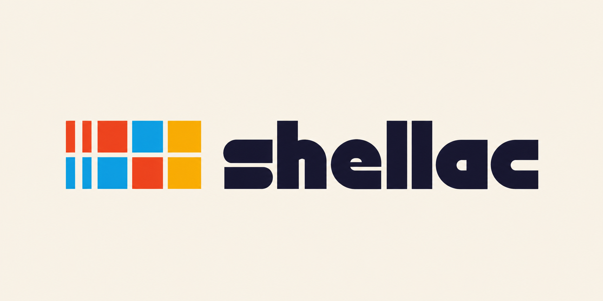

<p align="center"></p>
<h1 align="center"><b>Unruly</b></h1>
<h4 align="center">A music player whose entire interface is a swappable skin.</h4>
<p align="center">
    <a href="LICENSE"></a>
    <a href="skills/create-unruly-skin/LICENSE"></a>
    
</p>
<h4 align="center"><a href="CHANGELOG.md">Changelog</a> | <a href="ARCHITECTURE-NOTES.md">Architecture</a> | <a href="buildspec.md">Buildspec</a></h4>

## About

In Unruly a skin is the whole app: browsing, search, queue, now playing, lyrics, and the way you
move between them. An iPod click wheel and a Zune pivot don't share a layout, so Unruly doesn't
make them.

Built-in skins: **iPod**, **Zune HD**, **PSP XMB**, **iOS 6 Music** and **Winamp 2**. You can
also load your own.

Playback and indexing come from [Auxio](https://github.com/OxygenCobalt/Auxio), unchanged.

## Make your own skin

A user skin is a web page: HTML, CSS and JS zipped into a `.unruly` file. It talks to the player
through `window.unruly` and loads from **settings → skin → Load skin**, or by opening the file
on your phone.

The quickest way to make one is to ask a coding agent. This repo ships an agent skill,
[`create-unruly-skin`](skills/create-unruly-skin/SKILL.md), that takes a brief like *"make me
a skin that looks like a Walkman"* to a packed, tested `.unruly` file.

**Claude Code / Codex:** clone this repo and ask. The skill is already linked into
`.claude/skills/` and `.agents/skills/`. To use it in other projects, copy it:

```sh
cp -r skills/create-unruly-skin ~/.claude/skills/
```

**By hand:** the kit works without an agent too.

| | |
|---|---|
| [`reference/unruly.d.ts`](skills/create-unruly-skin/reference/unruly.d.ts) | The full skin API |
| [`template/`](skills/create-unruly-skin/template) | A small working skin to start from |
| `scripts/preview.mjs` | Run a skin in a desktop browser with a mock player and library |
| `scripts/shot.mjs` | Phone-sized headless screenshots, with scripted taps |
| `scripts/pack.mjs` | Validate like the app does and write the `.unruly` file |
| `scripts/push.mjs` | Install on a USB-connected phone (debug builds) |

You need Node 18+ and a Chromium-based browser for screenshots. The kit is MIT-licensed, so use
it however you like.

## Building

Linux, macOS or WSL2. Windows won't work because the patched Media3 build runs shell scripts.

- JDK 21
- Android SDK Platform 36 and Build Tools
- NDK 28.2.13676358 (exactly this version)
- `cmake` and `ninja`

```sh
git clone --recurse-submodules https://github.com/scarif-labs/unruly.git
cd unruly
(cd media && git apply ../patches/media-consumer-proguard-agp9.patch)
./gradlew assembleDebug
```

The first build compiles native code and takes 10–30 minutes. Re-apply the patch after any
`git submodule update`; [`patches/README.md`](patches/README.md) explains why.

## Layout

```
app/      Host: playback, service, indexer glue, settings, the web-skin runtime
skin/     The skin contract (AppSkin) and the built-in Compose skins
musikr/   Indexer and music models, native taglib
media/    Patched Media3 (submodule)
skills/   The create-unruly-skin agent skill and authoring kit
```

Skins can't touch the engine: `:skin` has no dependency on `:app` or `:musikr`. A skin gets a
`SkinSession` (playback state, library, commands, lyrics) and draws everything else. If a skin
crashes, Unruly falls back to a working one and tells you. See
[`ARCHITECTURE-NOTES.md`](ARCHITECTURE-NOTES.md) for details.

To add a built-in Compose skin, implement `AppSkin` in `skin/src/main/java/org/unruly/skin/`,
give it a stable `id` (it's persisted, so never change it), and register it in `SkinRegistry`.
The KDoc on [`AppSkin`](skin/src/main/java/org/unruly/skin/AppSkin.kt) lists the rules.

## License

The app is [GPL-3.0](LICENSE), inherited from Auxio. The skin kit in
[`skills/create-unruly-skin/`](skills/create-unruly-skin) is [MIT](skills/create-unruly-skin/LICENSE),
so skins you make with it are yours to license however you want.

Auxio is copyright the Auxio Project and remains the source of `musikr/`, the `media/` submodule
and the playback engine. Unruly isn't affiliated with Auxio; please report Unruly bugs here, not
upstream.
